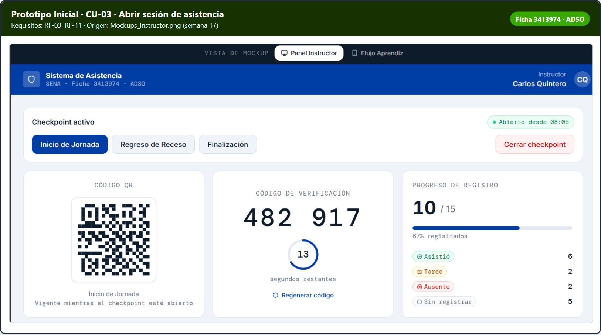
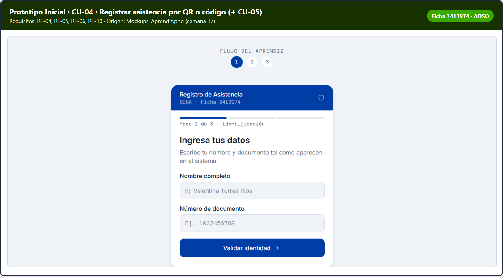
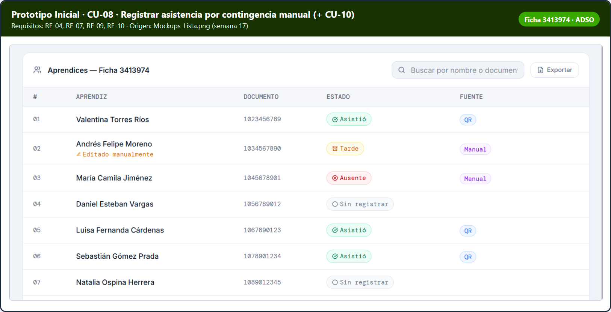
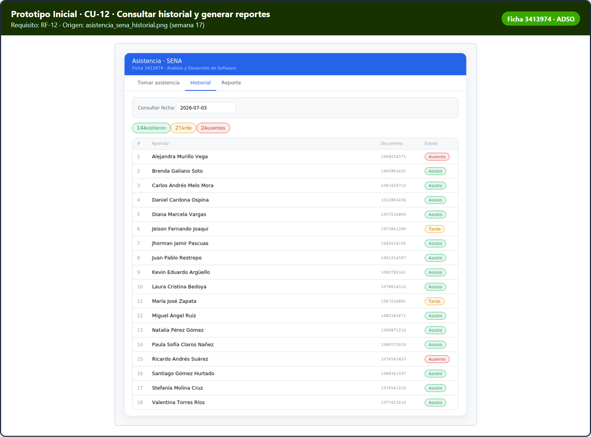

# Prototipo Inicial (Mockups Rotulados por Caso de Uso)

**Producto:** G1-P2 · Modelo de análisis y verificación  
**Origen reutilizado:** Pantallas originales diseñadas en `03-execute/17-week/02-optional-activity/` (`Mockups_Instructor.png`, `Mockups_Aprendiz.png`, `Mockups_Lista.png` y `asistencia_sena_historial.png`), rotuladas con el caso de uso y requisitos que atienden conforme a `Rubricas_G1.md` (C5).

---

## Catálogo de Pantallas del Prototipo (4 Pantallas Críticas)

| # | Archivo de pantalla rotulada | Caso de uso atendido | Requisitos cubiertos | Origen reutilizado |
| :- | :--- | :--- | :--- | :--- |
| 1 | [pantalla-01-cu03-abrir-sesion.png](pantalla-01-cu03-abrir-sesion.png) | `CU-03` · Abrir sesión de asistencia | `RF-03`, `RF-11` | `03-execute/17-week/02-optional-activity/Mockups_Instructor.png` |
| 2 | [pantalla-02-cu04-registro-aprendiz.png](pantalla-02-cu04-registro-aprendiz.png) | `CU-04` · Registrar asistencia por QR o código (+ `CU-05`) | `RF-04`, `RF-05`, `RF-06`, `RF-10` | `03-execute/17-week/02-optional-activity/Mockups_Aprendiz.png` |
| 3 | [pantalla-03-cu08-contingencia-manual.png](pantalla-03-cu08-contingencia-manual.png) | `CU-08` · Registrar asistencia por contingencia manual (+ `CU-10`) | `RF-04`, `RF-07`, `RF-09`, `RF-10` | `03-execute/17-week/02-optional-activity/Mockups_Lista.png` |
| 4 | [pantalla-04-cu12-historial-reportes.png](pantalla-04-cu12-historial-reportes.png) | `CU-12` · Consultar historial y generar reportes | `RF-12` | `03-execute/17-week/02-optional-activity/asistencia_sena_historial.png` |

---

## Vistas Previas Rotuladas

### Pantalla 1 — `CU-03`: Panel de Sesión Activa con QR Rotativo y Código Numérico

### Pantalla 2 — `CU-04`: Flujo Móvil de Autorregistro del Aprendiz

### Pantalla 3 — `CU-08`: Registro Manual y Control de Contingencia por Ficha

### Pantalla 4 — `CU-12`: Consulta de Historial y Resumen de Puntualidad

