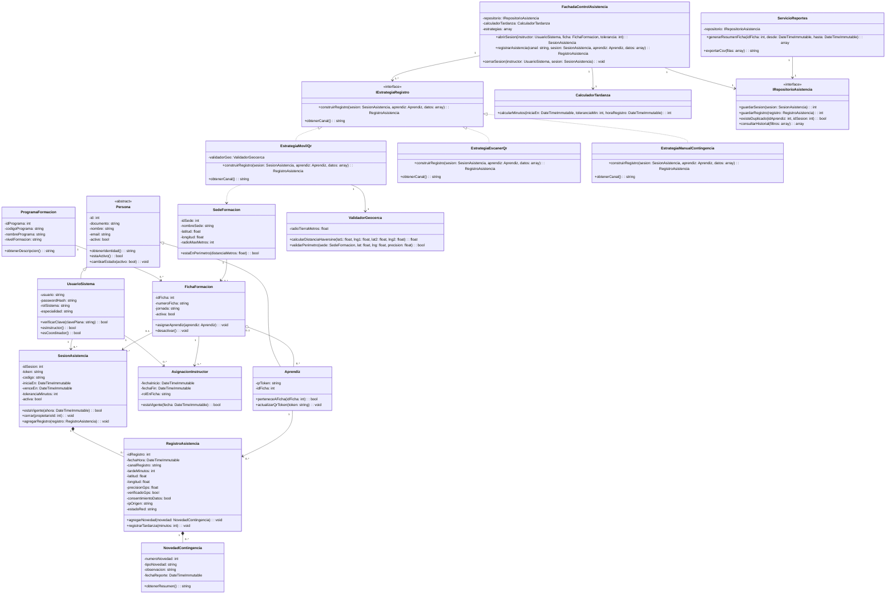

# A2 y A3 · Diagrama de Clases y Patrones de Diseño (GoF)

**Proyecto:** Sistema Web de Control de Asistencia SENA (`asistencia-sena`)  
**Producto:** G2-P1 · Artefactos de diseño (`RAP 593103`)  
**Autor:** `@andressalinasvargas` · **Fecha:** `2026-11-23`  
**Fuente editable:** [02-diagrama-clases.drawio](02-diagrama-clases.drawio) · **Imagen exportada:** [02-diagrama-clases.svg](02-diagrama-clases.svg)

---

## 1. Vista Rápida del Diagrama de Clases (`19` Elementos: `17` Clases + `2` Interfaces)

---

## 2. Catálogo de Clases y Principios Orientados a Objetos Aplicados

| Principio / Relación OO | Dónde se aplica en el diagrama | Justificación en `asistencia-sena` |
| :--- | :--- | :--- |
| **Herencia («es un»)** | `Persona` (`{abstract}`) ⇐ `UsuarioSistema`, `Aprendiz` | Comparte identidad (`id`, `documento`, `nombre`, `email`, `activo`) evitando duplicar atributos y comportamiento de activación lógica (`RF-02`). |
| **Agregación («tiene / agrupa»)** | `FichaFormacion "0..1" o-- "0..*" Aprendiz` | Un aprendiz puede existir temporalmente sin ficha o reasignarse entre fichas sin destruir su historial académico. |
| **Composición («es parte de»)** | `SesionAsistencia "1" *-- "0..*" RegistroAsistencia` y `RegistroAsistencia "1" *-- "0..*" NovedadContingencia` | Un registro de asistencia solo existe dentro de una sesión concreta y las novedades dependen totalmente de la existencia de su registro padre (`RF-07`, `RF-09`). |
| **Polimorfismo por interfaz** | `IEstrategiaRegistro` con `EstrategiaMovilQr`, `EstrategiaEscanerQr` y `EstrategiaManualContingencia` | `FachadaControlAsistencia` invoca `construirRegistro(...)` sobre la interfaz sin acoplarse ni usar condicionales gigantes para distinguir canales (`RF-05`, `RF-08`, `RF-09`). |
| **Alta cohesión (sin mezcla de áreas)** | Clases de negocio separadas de UI y de persistencia (`IRepositorioAsistencia`) y reportes separados en `ServicioReportes` | Ninguna clase de dominio mezcla HTML, SQL o generación CSV; cada clase atiende una única responsabilidad verificable en `06-matriz-trazabilidad-diseno.md`. |

---

## 3. Patrones de Diseño GoF Aplicados (A3)

Se incorporan **2 patrones GoF distintos** (ninguno es Singleton) reflejados directamente en las clases del diagrama:

| Patrón GoF | Problema concreto en `asistencia-sena` | Por qué este patrón y no condicionales planos | Clases e interfaces participantes | Qué mejora en mantenibilidad |
| :--- | :--- | :--- | :--- | :--- |
| **1. Estrategia (*Strategy*)** | La asistencia se captura por 3 canales con reglas distintas: **autorregistro móvil** (exige consentimiento Ley 1581 + validación GPS Haversine y precisión), **escáner QR del instructor** (valida token de credencial e instructor autenticado) y **contingencia manual** (valida propiedad del instructor + novedad opcional). Concentrar los 3 flujos en un solo método provoca acoplamiento alto y regresiones frecuentes. | Encapsula las variaciones de captura y validación detrás de un contrato único polimórfico (`IEstrategiaRegistro`), permitiendo sustituir o seleccionar dinámicamente el algoritmo por canal en tiempo de ejecución sin `if/switch` acoplados. | `IEstrategiaRegistro`, `EstrategiaMovilQr`, `EstrategiaEscanerQr`, `EstrategiaManualContingencia` *(cliente: `FachadaControlAsistencia`)*. | Agregar un futuro cuarto canal (por ejemplo lectura NFC o biometría institucional) requiere crear una nueva implementación de `IEstrategiaRegistro` sin modificar `SesionAsistencia`, `RegistroAsistencia` ni las demás estrategias. |
| **2. Fachada (*Facade*)** | Registrar o cerrar una asistencia obliga a coordinar múltiples colaboradores: verificar sesión vigente y duplicados en repositorio (`IRepositorioAsistencia`), ejecutar la estrategia del canal (`IEstrategiaRegistro`), validar geocerca (`ValidadorGeocerca`), calcular tardanza uniforme (`CalculadorTardanza`) y persistir el resultado. Exponer esa orquestación a la capa UI provocaría lógica duplicada (como ocurría antes entre registro móvil y manual) y riesgo de saltarse validaciones. | Provee un punto de entrada cohesivo de alto nivel (`FachadaControlAsistencia`) que oculta la complejidad del subsistema de asistencia y garantiza invariantes críticas (`RF-04`, `RF-07`, `RF-10`, `RF-11`) en un solo flujo uniforme para toda interfaz (`WebAppInstructor` y `WebAppMovilAprendiz`). | `FachadaControlAsistencia` *(coordina `IEstrategiaRegistro`, `CalculadorTardanza`, `IRepositorioAsistencia`, `SesionAsistencia`, `RegistroAsistencia`)*. | La UI no depende de múltiples servicios internos; si cambia la fórmula de tardanza o el repositorio PDO, los controladores web no cambian, reduciendo el acoplamiento entre capas y evitando duplicación de reglas de negocio. |
