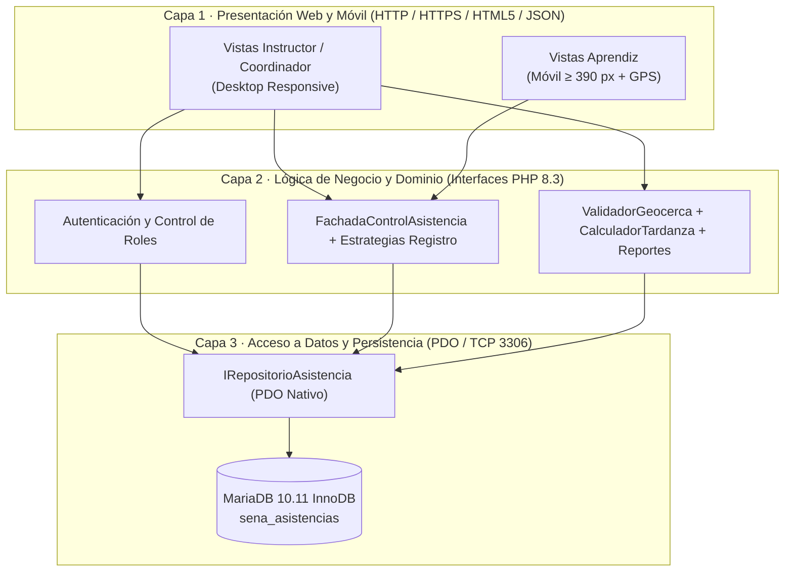

# A4 · Arquitectura del Software y Decisiones de Diseño

**Proyecto:** Sistema Web de Control de Asistencia SENA (`asistencia-sena`)  
**Producto:** G2-P1 · Artefactos de diseño (`RAP 593103`)  
**Autor:** `@andressalinasvargas` · **Fecha:** `2026-11-23`  
**Fuente editable:** [03-arquitectura-software.drawio](03-arquitectura-software.drawio) · **Imagen exportada:** [03-arquitectura-software.svg](03-arquitectura-software.svg)

---

## 1. Estilo Arquitectónico y Comunicación entre Capas

El sistema adopta una **Arquitectura en 3 Capas Estrictas (Presentación → Lógica de Negocio → Acceso a Datos y Persistencia)** sin saltos de capa:

1. **Capa 1 — Presentación Web y Móvil:** Vistas HTML5/CSS3 responsivas (`assets/app.css`, `layout.php`) y controladores de borde HTTP (`index.php`, `dashboard.php`, `tomar_asistencia.php`, `sesion.php`, `scanner.php`, `codigo.php`, `registro.php`, `politica_datos.php`). **Regla estricta:** solo gestiona entrada/salida HTTP, sesiones, tokens CSRF y escape de salida `e()`/`escHtml()`; **nunca ejecuta SQL directamente ni omite la capa de negocio**.
2. **Capa 2 — Lógica de Negocio y Dominio (POO):** Orquestada por `FachadaControlAsistencia`, estrategias `IEstrategiaRegistro`, servicios cohesivos (`ValidadorGeocerca`, `CalculadorTardanza`, `ServicioReportes`) y entidades de dominio (`UsuarioSistema`, `FichaFormacion`, `Aprendiz`, `SesionAsistencia`, `RegistroAsistencia`). Consume exclusivamente interfaces de persistencia (`IRepositorioAsistencia`).
3. **Capa 3 — Acceso a Datos y Persistencia:** Implementación PDO nativa sobre el contrato `IRepositorioAsistencia` conectado al motor relacional **MariaDB 10.11 (`InnoDB`)** mediante sentencias preparadas con emulación desactivada.

### Protocolo de Comunicación entre Capas
- **Navegador (Escritorio/Móvil) ↔ Capa de Presentación:** Peticiones `HTTPS (TLS 1.3)` con formularios HTTP `POST` (tokens CSRF) y respuestas `JSON` para lector QR (`registrar_asistencia.php`) o sondeo de registrados en vivo.
- **Capa de Presentación → Capa de Lógica de Negocio:** Invocaciones en memoria PHP 8.3 fuertemente tipadas hacia las interfaces `IAutenticacion`, `IGestionAcademica`, `IFachadaAsistencia` y `IReportesAuditoria`.
- **Capa de Lógica de Negocio → Capa de Acceso a Datos:** Contrato de repositorio `IRepositorioAsistencia` (desacopla reglas de negocio de SQL concreto).
- **Capa de Acceso a Datos → Motor MariaDB:** Protocolo nativo MySQL/MariaDB sobre `TCP 3306` en red privada interna con PDO (`ATTR_EMULATE_PREPARES => false`, transacciones ACID).

---

## 2. Tabla de Decisiones Arquitectónicas frente a los RNF

| RNF / Estilo | Decisión de diseño | Alternativa descartada | Razón concreta del descarte |
| :--- | :--- | :--- | :--- |
| **Estilo arquitectónico** | **3 Capas estrictas** sin saltos de capa, separando vistas HTTP, servicios/fachada POO y repositorio PDO. | **Monolito acoplado de 1 sola capa** (PHP con consultas SQL dentro de plantillas HTML) o **Microservicios distribuidos**. | Un monolito de 1 capa mezcla SQL con HTML, duplica reglas de tardanza y dificulta pruebas; microservicios agregan latencia de red, sobrecarga operativa y complejidad injustificada para 1 equipo/institución pequeña. |
| **RNF-01 · Seguridad y Control de Acceso** | Validar sesión, rol, propiedad (`creada_por = instructor`) y token CSRF en la capa de lógica/controlador + consultas preparadas PDO (`ATTR_EMULATE_PREPARES => false`) en acceso a datos; blindaje `.htaccess` para recursos internos. | Validar permisos solo en interfaz/JavaScript o usar consultas SQL concatenadas. | Las validaciones solo en cliente pueden eludirse con peticiones `POST`/`curl` directas al endpoint; la concatenación SQL expone inyección SQL. |
| **RNF-02 · Cumplimiento Legal (Ley 1581)** | Exigir aceptación expresa previa en `EstrategiaMovilQr` antes de invocar persistencia y usar borrado lógico (`activo = 0`) en `Aprendiz` y `FichaFormacion`. | Eliminación física (`DELETE FROM aprendices`) o registro implícito sin checkbox de autorización. | El `DELETE` físico rompe la integridad referencial histórica de asistencias y vulnera auditoría SENA; registrar sin autorización explícita incumple Habeas Data colombiano. |
| **RNF-03 · Rendimiento (`≤ 2 s`)** | Conexión PDO *singleton* por petición sin sentencias DDL (`SHOW/ALTER`) en tiempo de ejecución + índices únicos y por fecha en `InnoDB` + carga modular de activos (`app.css`). | Ejecutar verificación DDL (`ensure_schema`) en cada solicitud HTTP o cargar *frameworks* SPA pesados. | Ejecutar DDL por petición añade ~11 consultas innecesarias bajo concurrencia al inicio de clase; un SPA pesado ralentiza móviles básicos. |
| **RNF-04 · Usabilidad Móvil (`≤ 3 pasos`)** | Flujo móvil dedicado en `codigo.php` + `registro.php` con hoja de estilo unificada responsiva (`≤ 600 px`), mensajes en español claros y escape `escHtml()` en lector. | Panel único administrativo comprimido para celular o app nativa obligatoria por tienda. | Obligar instalación nativa frena el registro en aula cuando el aprendiz cambia de teléfono o tiene poco almacenamiento; un layout de escritorio en móvil exige zoom horizontal. |
| **RNF-05 · Disponibilidad y Contingencia** | Desacoplar 3 canales polimórficos detrás de `IEstrategiaRegistro` (QR rotativo/código 6 dígitos móvil, escáner del instructor y registro manual con novedad). | Depender únicamente de lectura QR por cámara móvil con GPS obligatorio. | Fallos de cámara, ausencia de teléfono o señal GPS inestable en aulas cerradas paralizarían el llamado a lista. |
| **RNF-06 · Integridad y Auditoría** | Restricción compuesta `UNIQUE(id_aprendiz, id_sesion)` en `InnoDB`, entidad dependiente `NovedadContingencia` y registro automático de `tarde_minutos`, `ip_origen` y `estado_red` en servidor. | Confiar en reloj/IP reportada desde navegador cliente o validar duplicados solo en PHP. | El reloj/cabeceras del cliente son manipulables y el chequeo no atómico en PHP falla ante doble clic concurrente (`race condition`). |
