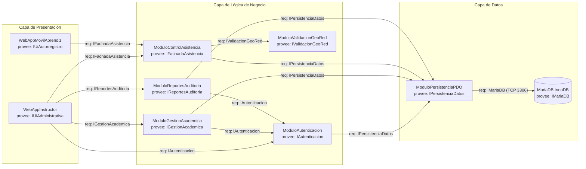

# A5 · Vista de Componentes

**Proyecto:** Sistema Web de Control de Asistencia SENA (`asistencia-sena`)  
**Producto:** G2-P1 · Artefactos de diseño (`RAP 593103`)  
**Autor:** `@andressalinasvargas` · **Fecha:** `2026-11-23`  
**Fuente editable:** [04-vista-componentes.drawio](04-vista-componentes.drawio) · **Imagen exportada:** [04-vista-componentes.svg](04-vista-componentes.svg)

---

## 1. Diagrama de Componentes e Interfaces (`8` Componentes)

La dirección de las dependencias respeta estrictamente las **3 capas**: los componentes de presentación dependen únicamente de interfaces de lógica de negocio, y solo los módulos de negocio invocan el contrato de persistencia `IPersistenciaDatos`.

---

## 2. Catálogo de Componentes, Interfaces, Clases y Requisitos

| Componente | Interfaz que provee | Interfaz(ces) que requiere | Clases / elementos que agrupa (de `A2` / vistas HTTP) | Requisitos que atiende |
| :--- | :--- | :--- | :--- | :--- |
| **`WebAppInstructor`** | `IUiAdministrativa` | `IAutenticacion`, `IGestionAcademica`, `IFachadaAsistencia`, `IReportesAuditoria` | Controladores y vistas desktop (`index.php`, `dashboard.php`, `aprendices.php`, `qr.php`, `tomar_asistencia.php`, `sesion.php`, `cerrar_sesion.php`, `scanner.php`, `registro_manual.php`, `asistencias.php`) | `RF-01`, `RF-02`, `RF-03`, `RF-08`, `RF-09`, `RF-11`, `RF-12`, `RNF-01`, `RNF-04` |
| **`WebAppMovilAprendiz`** | `IUiAutorregistro` | `IFachadaAsistencia` | Vistas móviles HTML5 (`codigo.php`, `registro.php`, `politica_datos.php`) y solicitud de `Geolocation API` en cliente | `RF-05`, `RF-06`, `RNF-02`, `RNF-04`, `RNF-05` |
| **`ModuloAutenticacion`** | `IAutenticacion` | `IPersistenciaDatos` | `Persona`, `UsuarioSistema` (validación BCrypt, gestión de sesión HTTP, roles `Instructor`/`Coordinador` y tokens CSRF) | `RF-01`, `RNF-01` |
| **`ModuloGestionAcademica`** | `IGestionAcademica` | `IAutenticacion`, `IPersistenciaDatos` | `ProgramaFormacion`, `SedeFormacion`, `FichaFormacion`, `Aprendiz`, `AsignacionInstructor` | `RF-02`, `RNF-02` |
| **`ModuloControlAsistencia`** | `IFachadaAsistencia` | `IValidacionGeoRed`, `IPersistenciaDatos` | `FachadaControlAsistencia`, `SesionAsistencia`, `RegistroAsistencia`, `NovedadContingencia`, `IEstrategiaRegistro`, `EstrategiaMovilQr`, `EstrategiaEscanerQr`, `EstrategiaManualContingencia`, `CalculadorTardanza` | `RF-03`, `RF-04`, `RF-05`, `RF-07`, `RF-08`, `RF-09`, `RF-10`, `RF-11`, `RNF-05`, `RNF-06` |
| **`ModuloValidacionGeoRed`** | `IValidacionGeoRed` | `IGeolocationNavegador` *(API navegador cliente)* | `ValidadorGeocerca` (cálculo Haversine, umbral de precisión `≤ 100 m`, inspección de IP y cabeceras de proxy) | `RF-06`, `RNF-01`, `RNF-02`, `RNF-04`, `RNF-06` |
| **`ModuloReportesAuditoria`** | `IReportesAuditoria` | `IAutenticacion`, `IPersistenciaDatos` | `ServicioReportes` (listado en vivo, historial por fecha/ficha, métricas de tardanza, alertas de red y exportación CSV) | `RF-12`, `RNF-03`, `RNF-06` |
| **`ModuloPersistenciaPDO`** | `IPersistenciaDatos` | `IMariaDB` *(motor relacional)* | `IRepositorioAsistencia` (implementación PDO nativa con sentencias preparadas, manejo de `SQLSTATE 23000` y transacciones ACID) | `RF-01`–`RF-12`, `RNF-01`, `RNF-03`, `RNF-06` |

> **Verificación de reglas de arquitectura (`A4` + `A5`):** Las interfaces de acceso a datos (`IPersistenciaDatos`) nunca son consumidas directamente por `WebAppInstructor` ni `WebAppMovilAprendiz`, garantizando separación estricta de responsabilidades entre presentación, negocio y datos.
