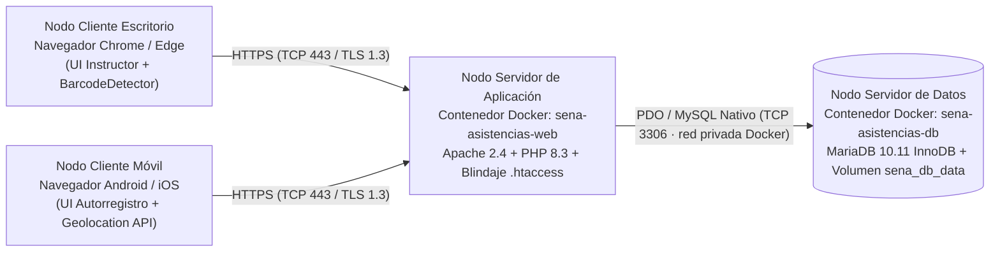

# A6 · Vista de Despliegue

**Proyecto:** Sistema Web de Control de Asistencia SENA (`asistencia-sena`)  
**Producto:** G2-P1 · Artefactos de diseño (`RAP 593103`)  
**Autor:** `@andressalinasvargas` · **Fecha:** `2026-11-23`  
**Fuente editable:** [05-vista-despliegue.drawio](05-vista-despliegue.drawio) · **Imagen exportada:** [05-vista-despliegue.svg](05-vista-despliegue.svg)

---

## 1. Diagrama de Nodos de Despliegue (`4` Nodos)

> Nota de desarrollo local: en ambiente local controlado con Docker Compose, el puerto publicado hacia la estación de trabajo es `HTTP 8090 -> 80/tcp`; en producción institucional SENA se publica detrás de proxy inverso TLS en `HTTPS 443`, requisito obligatorio de los navegadores para `Geolocation API` y cámara `BarcodeDetector`.

---

## 2. Especificación de Nodos, Artefactos, Protocolos y Decisiones RNF

| Nodo | Entorno / Contenedor | Artefactos alojados | Conexión (protocolo y puerto) | Decisión de despliegue que responde a un RNF |
| :--- | :--- | :--- | :--- | :--- |
| **1. Cliente Escritorio** | Estación del Instructor / Coordinador (`Chrome` / `Edge` actuales) | Interfaz `WebAppInstructor`, lector de cámara `BarcodeDetector` (`scanner.php`) y `assets/app.css` en caché del navegador | Salida `HTTPS` (`TCP 443`, `TLS 1.2/1.3`) hacia Servidor de Aplicación | **RNF-01, RNF-03:** canal cifrado obligatorio para habilitar lectura de cámara en navegador y proteger cookies `HttpOnly` + credenciales de inicio de sesión. |
| **2. Cliente Móvil** | Teléfono inteligente del Aprendiz (`Android` / `iOS`, pantalla `≥ 390 px`) | Interfaz `WebAppMovilAprendiz` (`codigo.php`, `registro.php`, `politica_datos.php`) + `Geolocation API` HTML5 | Salida `HTTPS` (`TCP 443`, `TLS 1.2/1.3`) hacia Servidor de Aplicación | **RNF-02, RNF-04:** habilita obtención segura de coordenadas GPS tras consentimiento previo Ley 1581 sin instalar app nativa. |
| **3. Servidor de Aplicación** | Contenedor `sena-asistencias-web` (`Apache 2.4 + PHP 8.3`, `TZ=America/Bogota`) | Controladores PHP, módulos de negocio (`FachadaControlAsistencia`, estrategias, servicios), repositorio PDO y reglas Apache `.htaccess` + `docs/.htaccess` | Entrada `HTTPS 443` (proxy TLS -> Apache `80/tcp`); salida `TCP 3306` por red puente privada hacia Datos | **RNF-01, RNF-03, RNF-05:** reglas `.htaccess` responden `HTTP 403 Forbidden` en `config.php`, `*.sql`, `Dockerfile`, `/docs/` y `/e2e/`; cabeceras `X-Frame-Options: SAMEORIGIN` y `X-Content-Type-Options: nosniff`; *healthcheck* HTTP periódico para alta disponibilidad. |
| **4. Servidor de Datos** | Contenedor `sena-asistencias-db` (`MariaDB 10.11`, motor `InnoDB`, `utf8mb4`) | Esquema relacional `sena_asistencias` (`10` tablas normalizadas), volumen persistente `sena_db_data` y rutina de respaldo `mysqldump` | Entrada exclusiva `TCP 3306` desde `sena-asistencias-web` en red privada interna (puerto `3306` sin exposición a Internet) | **RNF-01, RNF-06:** aislamiento total del motor relacional frente a Internet, persistencia en volumen independiente al ciclo de vida del contenedor y preservación de trazas históricas ante reinicios. |
