# A2 y A3 · Diagrama de Clases OO y Patrones de Diseño GoF (`Fotocopiadora SyP`)

**Proyecto:** Plataforma Web E-commerce y Servicio Técnico **Fotocopiadora SyP**  
**Producto:** G2-P1 · Artefactos de diseño (`RAP 593103`)  
**Autor:** `@andressalinasvargas` · **Fecha:** `2026-11-27`  
**Fuente editable:** [02-diagrama-clases.drawio](02-diagrama-clases.drawio) · **Imagen exportada:** [02-diagrama-clases.svg](02-diagrama-clases.svg)

---

## 1. Vista Rápida del Diagrama de Clases (`24` Elementos: `21` Clases + `3` Interfaces)

```mermaid
classDiagram
  direction TB

  class Persona {
    <<abstract>>
    -id: int
    -nombreCompleto: string
    -correo: string
    -activo: bool
    +estaActivo(): bool
  }
  class Cliente {
    -documento: string
    -ciudad: string
    +esTitular(): bool
  }
  class Administrador {
    -cargo: string
    -ultimoIngreso: datetime
    +puedeAdministrar(): bool
  }
  class Categoria {
    -idCategoria: int
    -slug: string
    +obtenerResumen(): string
  }
  class Producto {
    -idProducto: int
    -precioCop: float
    -estadoStock: string
    +estaDisponible(): bool
    +esCompatibleCon(id: int): bool
  }
  class CarritoCompra {
    -items: array
    -subtotalCop: float
    +recalcularTotal(): float
  }
  class Pedido {
    -codigoPedido: string
    -totalCobrado: float
    -estadoPago: string
    +confirmar(datos: array): void
  }
  class DetallePedido {
    -cantidad: int
    -precioPactado: float
    +calcularSubtotal(): float
  }
  class Cotizacion {
    -codigoCotizacion: string
    -totalCotizado: float
    +generarPdfImprimible(): void
  }
  class DetalleCotizacion {
    -cantidad: int
    -precioCotizado: float
    +calcularLinea(): float
  }
  class Notificacion {
    -titulo: string
    -leida: bool
    +marcarLeida(): void
  }
  class SolicitudServicio {
    -codigo: string
    -tipoServicio: string
    -estado: string
    +actualizarEstado(e: string): void
  }
  class ReporteContador {
    -contadorBn: int
    -contadorColor: int
    -mes: string
    +registrarLectura(): void
  }
  class MensajeContacto {
    -asunto: string
    -leido: bool
    +marcarAtendido(): void
  }
  class ExportadorCsvSeguro {
    +sanitizarCelda(v: string): string
    +exportarTabla(filas: array): string
  }
  class IRepositorioComercial {
    <<interface>>
    +guardarPedido(p: Pedido): int
    +guardarCotizacion(c: Cotizacion): int
    +listarProductos(f: array): array
  }
  class DespachadorComandos {
    -historial: array
    +despachar(cmd: IComandoOperacion): array
  }
  class IComandoOperacion {
    <<interface>>
    +validar(): bool
    +ejecutar(): array
  }
  class ComandoConfirmarPedido {
    -pedido: Pedido
    +validar(): bool
    +ejecutar(): array
  }
  class ComandoEmitirCotizacion {
    -cotizacion: Cotizacion
    +validar(): bool
    +ejecutar(): array
  }
  class ComandoRadicarSolicitud {
    -solicitud: SolicitudServicio
    +validar(): bool
    +ejecutar(): array
  }
  class IFabricaEntregaComercial {
    <<interface>>
    +crearDocumento(): object
    +crearNotificacion(msg: string): Notificacion
  }
  class FabricaEntregaPedido {
    +crearDocumento(): Pedido
    +crearNotificacion(msg: string): Notificacion
  }
  class FabricaEntregaCotizacion {
    +crearDocumento(): Cotizacion
    +crearNotificacion(msg: string): Notificacion
  }

  Persona <|-- Cliente
  Persona <|-- Administrador
  Persona "1" *-- "0..*" Notificacion
  Categoria "1" o-- "1..*" Producto
  CarritoCompra "1" o-- "0..*" Producto
  Pedido "1" *-- "1..*" DetallePedido
  Cotizacion "1" *-- "1..*" DetalleCotizacion
  Cliente "0..1" --> "0..*" Pedido
  Cliente "0..1" --> "0..*" SolicitudServicio
  Cliente "1" --> "0..*" ReporteContador
  DespachadorComandos "1" --> "0..*" IComandoOperacion
  IComandoOperacion <|.. ComandoConfirmarPedido
  IComandoOperacion <|.. ComandoEmitirCotizacion
  IComandoOperacion <|.. ComandoRadicarSolicitud
  ComandoConfirmarPedido ..> IRepositorioComercial
  ComandoConfirmarPedido ..> IFabricaEntregaComercial
  IFabricaEntregaComercial <|.. FabricaEntregaPedido
  IFabricaEntregaComercial <|.. FabricaEntregaCotizacion
```

---

## 2. Principios Orientados a Objetos y Regla de Alta Cohesión (`A2`)

| Principio / Relación OO | Dónde se aplica | Justificación en `Fotocopiadora SyP` |
| :--- | :--- | :--- |
| **Herencia («es un»)** | `Persona` (`{abstract}`) ⇐ `Cliente`, `Administrador` | Reutiliza identidad, credenciales y estado de cuenta (`RF-07`, `RNF-05`), diferenciando atributos tributarios de cliente frente a cargo operativo de administrador. |
| **Agregación (`o--`)** | `Categoria "1" o-- "1..*" Producto` y `CarritoCompra "1" o-- "0..*" Producto` | Un producto puede reasignarse entre categorías o retirarse del carrito sin destruir la existencia del producto en el catálogo (`RF-02`, `RF-04`). |
| **Composición (`*--`)** | `Pedido *-- DetallePedido`, `Cotizacion *-- DetalleCotizacion` y `Persona *-- Notificacion` | Las líneas de detalle congeladas y las notificaciones de usuario no tienen ciclo de vida independiente si desaparece el documento o titular padre (`RF-05`, `RF-06`, `RF-12`). |
| **Polimorfismo por interfaz** | `IComandoOperacion` (3 implementaciones) e `IFabricaEntregaComercial` (2 implementaciones) | El despachador y los casos de uso invocan contratos polimórficos sin acoplarse a tipos concretos de operación ni mezclar creación documental. |
| **Alta cohesión (sin mezcla de áreas)** | Dominio puro separado de `IRepositorioComercial` (persistencia) y `ExportadorCsvSeguro` (reportes) | Ninguna clase de negocio mezcla código HTML/JS, SQL directo ni lógica de exportación CSV (`RF-11`). |

---

## 3. Patrones de Diseño GoF Propios Aplicados (`A3` — Ninguno es Singleton)

Para este diseño individual se seleccionaron dos patrones GoF orientados a **operaciones transaccionales desacopladas** y **creación coherente de familias documentales** (distintos de Singleton y del enfoque usado en los otros entregables del equipo):

| Patrón GoF | Problema concreto del caso | Por qué este patrón y no alternativas acopladas | Clases e interfaces participantes | Qué mejora en mantenibilidad |
| :--- | :--- | :--- | :--- | :--- |
| **1. Comando (*Command*)** | Confirmar un pedido (`RF-05`), emitir una cotización (`RF-06`) y radicar una solicitud de servicio (`RF-09`) requieren validaciones previas, prevención de doble envío (`RNF-05`), ejecución transaccional y registro de auditoría/reintento ante cortes de red (`RNF-06`). Colocar todo dentro de controladores HTTP provoca duplicación y dificultad para reintentar o encolar operaciones. | Encapsula cada solicitud de negocio como un objeto uniforme con `validar()` y `ejecutar()` bajo el contrato `IComandoOperacion`, controlado por `DespachadorComandos`. Evita controladores monolíticos con condicionales extensos. | `DespachadorComandos`, `IComandoOperacion`, `ComandoConfirmarPedido`, `ComandoEmitirCotizacion`, `ComandoRadicarSolicitud`. | Añadir una nueva operación transaccional (por ejemplo devolución de pedido o renovación de renting) consiste en implementar una clase nueva de `IComandoOperacion` sin modificar el despachador ni los comandos existentes. |
| **2. Fábrica Abstracta (*Abstract Factory*)** | Cada transacción comercial aprobada (`Pedido` o `Cotizacion`) debe crear una **familia consistente de objetos relacionados**: el documento con su numeración/IVA (`Pedido`/`Cotizacion`) junto con su notificación asociada (`Notificacion` específica de pedido o de cotización para `RF-12`). Instanciar ambos manualmente en varios servicios generaba notificaciones desalineadas o códigos inconsistentes. | Garantiza por diseño que toda creación documental vaya acompañada del aviso compatible mediante `IFabricaEntregaComercial`, sin exponer clases concretas ni usar un *Singleton* global de configuración. | `IFabricaEntregaComercial`, `FabricaEntregaPedido`, `FabricaEntregaCotizacion` *(producen `Pedido`/`Cotizacion` + `Notificacion`)*. | Permite agregar en el futuro una familia completa de `ContratoRenting` + `NotificacionRenting` implementando la interfaz sin tocar los comandos de negocio. |
