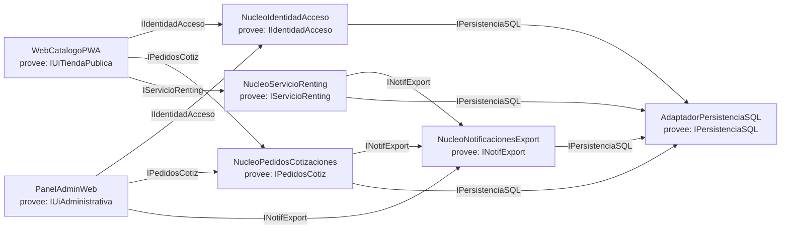

# A5 · Vista de Componentes (`7` Componentes — `Fotocopiadora SyP`)

**Proyecto:** Plataforma Web E-commerce y Servicio Técnico **Fotocopiadora SyP**  
**Producto:** G2-P1 · Artefactos de diseño (`RAP 593103`)  
**Autor:** `@andressalinasvargas` · **Fecha:** `2026-11-27`  
**Fuente editable:** [04-vista-componentes.drawio](04-vista-componentes.drawio) · **Imagen exportada:** [04-vista-componentes.svg](04-vista-componentes.svg)

---

## 1. Diagrama de Componentes e Interfaces (`7` Componentes)

---

## 2. Catálogo de Componentes, Interfaces, Clases y Requisitos

| Componente | Interfaz provista | Interfaces requeridas | Clases / módulos que agrupa | Requisitos atendidos |
| :--- | :--- | :--- | :--- | :--- |
| **`WebCatalogoPWA`** | `IUiTiendaPublica` | `IIdentidadAcceso`, `IPedidosCotiz`, `IServicioRenting` | Vistas públicas (`index.html`, `productos.html`, `cotizacion.html`, `servicio-tecnico.html`, `contacto.html`), `CarritoCompra`, caché `sw.js` | `RF-01`, `RF-02`, `RF-03`, `RF-04`, `RF-08`, `RNF-01`, `RNF-02`, `RNF-03`, `RNF-04`, `RNF-06` |
| **`PanelAdminWeb`** | `IUiAdministrativa` | `IIdentidadAcceso`, `IPedidosCotiz`, `INotifExport` | Vistas `admin.html`, `login.html` y controles de analítica, catálogo y estados | `RF-07`, `RF-11`, `RNF-05`, `RNF-07` |
| **`NucleoIdentidadAcceso`** | `IIdentidadAcceso` | `IPersistenciaSQL` | `Persona`, `Cliente`, `Administrador`, validación `BCrypt`, emisión/verificación `JWT` en cookie `HttpOnly` y control `is_owner` | `RF-07`, `RNF-05` |
| **`NucleoPedidosCotizaciones`** | `IPedidosCotiz` | `IIdentidadAcceso`, `IPersistenciaSQL`, `INotifExport` | `Categoria`, `Producto`, `Pedido`, `DetallePedido`, `Cotizacion`, `DetalleCotizacion`, `DespachadorComandos`, `ComandoConfirmarPedido`, `ComandoEmitirCotizacion`, `IFabricaEntregaComercial` | `RF-02`, `RF-03`, `RF-05`, `RF-06`, `RF-11`, `RNF-05`, `RNF-07` |
| **`NucleoServicioRenting`** | `IServicioRenting` | `IIdentidadAcceso`, `IPersistenciaSQL`, `INotifExport` | `SolicitudServicio`, `ReporteContador`, `MensajeContacto`, `ComandoRadicarSolicitud` | `RF-08`, `RF-09`, `RF-10`, `RNF-06` |
| **`NucleoNotificacionesExport`** | `INotifExport` | `IPersistenciaSQL` | `Notificacion`, `ExportadorCsvSeguro` (sanitización contra inyección de fórmulas `=,+,-,@`) | `RF-11`, `RF-12`, `RNF-05`, `RNF-08` |
| **`AdaptadorPersistenciaSQL`** | `IPersistenciaSQL` | `MotorRelacional` | `IRepositorioComercial`, implementación SQLAlchemy sobre las `12` tablas 3FN en PostgreSQL/SQLite | `RF-02`–`RF-12`, `RNF-05`, `RNF-08` |
