> **Spanish version (official rubric root):** [../02-diagrama-clases-y-patrones.md](../02-diagrama-clases-y-patrones.md)

# A2 & A3 · OO Class Diagram and GoF Design Patterns (`Fotocopiadora SyP`)

**Project:** Web E-Commerce & Technical Service Platform **Fotocopiadora SyP**  
**Product:** G2-P1 · Design artifacts (`RAP 593103`)  
**Author:** `@andressalinasvargas` · **Date:** `2026-11-27`  
**Editable source:** [../02-diagrama-clases.drawio](../02-diagrama-clases.drawio) · **Exported image:** [../02-diagrama-clases.svg](../02-diagrama-clases.svg)

*(Class, interface, attribute, and method identifiers stay aligned with the diagram `02-diagrama-clases.svg`).*

---

## 1. Class Diagram Quick View (`24` Elements: `21` Classes + `3` Interfaces)

```mermaid
classDiagram
  direction TB

  class Persona {
    <<abstract>>
    -id: int
    -nombreCompleto: string
    -correo: string
    -activo: bool
    +estaActivo(): bool
  }
  class Cliente {
    -documento: string
    -ciudad: string
    +esTitular(): bool
  }
  class Administrador {
    -cargo: string
    -ultimoIngreso: datetime
    +puedeAdministrar(): bool
  }
  class Categoria {
    -idCategoria: int
    -slug: string
    +obtenerResumen(): string
  }
  class Producto {
    -idProducto: int
    -precioCop: float
    -estadoStock: string
    +estaDisponible(): bool
    +esCompatibleCon(id: int): bool
  }
  class CarritoCompra {
    -items: array
    -subtotalCop: float
    +recalcularTotal(): float
  }
  class Pedido {
    -codigoPedido: string
    -totalCobrado: float
    -estadoPago: string
    +confirmar(datos: array): void
  }
  class DetallePedido {
    -cantidad: int
    -precioPactado: float
    +calcularSubtotal(): float
  }
  class Cotizacion {
    -codigoCotizacion: string
    -totalCotizado: float
    +generarPdfImprimible(): void
  }
  class DetalleCotizacion {
    -cantidad: int
    -precioCotizado: float
    +calcularLinea(): float
  }
  class Notificacion {
    -titulo: string
    -leida: bool
    +marcarLeida(): void
  }
  class SolicitudServicio {
    -codigo: string
    -tipoServicio: string
    -estado: string
    +actualizarEstado(e: string): void
  }
  class ReporteContador {
    -contadorBn: int
    -contadorColor: int
    -mes: string
    +registrarLectura(): void
  }
  class MensajeContacto {
    -asunto: string
    -leido: bool
    +marcarAtendido(): void
  }
  class ExportadorCsvSeguro {
    +sanitizarCelda(v: string): string
    +exportarTabla(filas: array): string
  }
  class IRepositorioComercial {
    <<interface>>
    +guardarPedido(p: Pedido): int
    +guardarCotizacion(c: Cotizacion): int
    +listarProductos(f: array): array
  }
  class DespachadorComandos {
    -historial: array
    +despachar(cmd: IComandoOperacion): array
  }
  class IComandoOperacion {
    <<interface>>
    +validar(): bool
    +ejecutar(): array
  }
  class ComandoConfirmarPedido {
    -pedido: Pedido
    +validar(): bool
    +ejecutar(): array
  }
  class ComandoEmitirCotizacion {
    -cotizacion: Cotizacion
    +validar(): bool
    +ejecutar(): array
  }
  class ComandoRadicarSolicitud {
    -solicitud: SolicitudServicio
    +validar(): bool
    +ejecutar(): array
  }
  class IFabricaEntregaComercial {
    <<interface>>
    +crearDocumento(): object
    +crearNotificacion(msg: string): Notificacion
  }
  class FabricaEntregaPedido {
    +crearDocumento(): Pedido
    +crearNotificacion(msg: string): Notificacion
  }
  class FabricaEntregaCotizacion {
    +crearDocumento(): Cotizacion
    +crearNotificacion(msg: string): Notificacion
  }

  Persona <|-- Cliente
  Persona <|-- Administrador
  Persona "1" *-- "0..*" Notificacion
  Categoria "1" o-- "1..*" Producto
  CarritoCompra "1" o-- "0..*" Producto
  Pedido "1" *-- "1..*" DetallePedido
  Cotizacion "1" *-- "1..*" DetalleCotizacion
  Cliente "0..1" --> "0..*" Pedido
  Cliente "0..1" --> "0..*" SolicitudServicio
  Cliente "1" --> "0..*" ReporteContador
  DespachadorComandos "1" --> "0..*" IComandoOperacion
  IComandoOperacion <|.. ComandoConfirmarPedido
  IComandoOperacion <|.. ComandoEmitirCotizacion
  IComandoOperacion <|.. ComandoRadicarSolicitud
  ComandoConfirmarPedido ..> IRepositorioComercial
  ComandoConfirmarPedido ..> IFabricaEntregaComercial
  IFabricaEntregaComercial <|.. FabricaEntregaPedido
  IFabricaEntregaCotizacion ..|> IFabricaEntregaComercial
```

---

## 2. Object-Oriented Principles and High Cohesion (`A2`)

| OO Principle / Relationship | Applied to | Rationale in `Fotocopiadora SyP` |
|---|---|---|
| **Inheritance ("is-a")** | `Persona` (`{abstract}`) ⇐ `Cliente`, `Administrador` | Reuses identity, credentials, and active state (`RF-07`, `RNF-05`), separating customer tax fields from administrator operational role. |
| **Aggregation (`o--`)** | `Categoria "1" o-- "1..*" Producto` & `CarritoCompra "1" o-- "0..*" Producto` | Products can move between categories or be removed from a cart without destroying catalog product records (`RF-02`, `RF-04`). |
| **Composition (`*--`)** | `Pedido *-- DetallePedido`, `Cotizacion *-- DetalleCotizacion`, `Persona *-- Notificacion` | Frozen detail lines and user notifications have no independent lifecycle if the parent document or user ceases to exist (`RF-05`, `RF-06`, `RF-12`). |
| **Interface polymorphism** | `IComandoOperacion` (`3` implementations) & `IFabricaEntregaComercial` (`2` implementations) | Dispatcher and use cases invoke polymorphic contracts without coupling to concrete operation or factory classes. |
| **High cohesion (no mixed layers)** | Pure domain separated from `IRepositorioComercial` (persistence) and `ExportadorCsvSeguro` (reports) | No business class mixes HTML/JS, raw SQL, or CSV export logic (`RF-11`). |

---

## 3. Applied Own GoF Design Patterns (`A3` — Neither is Singleton)

| GoF Pattern | Concrete domain problem | Why this pattern over coupled alternatives | Participating classes/interfaces | Maintainability benefit |
|---|---|---|---|---|
| **1. Command** | Confirming an order (`RF-05`), issuing a quote (`RF-06`), and filing a service request (`RF-09`) require pre-validation, duplicate-submission prevention (`RNF-05`), transactional execution, and audit/retry handling (`RNF-06`). | Encapsulates each transactional request uniformly with `validar()` and `ejecutar()` under `IComandoOperacion`, orchestrated by `DespachadorComandos`, avoiding monolithic HTTP controllers. | `DespachadorComandos`, `IComandoOperacion`, `ComandoConfirmarPedido`, `ComandoEmitirCotizacion`, `ComandoRadicarSolicitud`. | Adding a new transactional action (e.g., return or renting renewal) only requires implementing a new `IComandoOperacion` class. |
| **2. Abstract Factory** | Every approved commercial transaction (`Pedido` or `Cotizacion`) must create a **consistent family of related objects**: the numbered document plus its matching notification (`Notificacion` for `RF-12`). Instantiating both manually across services risks mismatched alerts. | Guarantees by contract (`IFabricaEntregaComercial`) that document creation always pairs with its matching notification without exposing concrete classes or global *Singleton* state. | `IFabricaEntregaComercial`, `FabricaEntregaPedido`, `FabricaEntregaCotizacion`. | Adding a new `ContratoRenting` + `NotificacionRenting` family requires only implementing the interface without editing business commands. |
