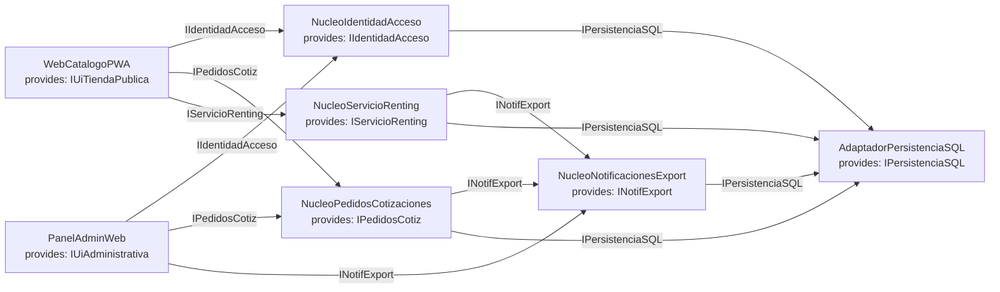

> **Spanish version (official rubric root):** [../04-vista-componentes.md](../04-vista-componentes.md)

# A5 · Component View (`7` Components — `Fotocopiadora SyP`)

**Project:** Web E-Commerce & Technical Service Platform **Fotocopiadora SyP**  
**Product:** G2-P1 · Design artifacts (`RAP 593103`)  
**Author:** `@andressalinasvargas` · **Date:** `2026-11-27`  
**Editable source:** [../04-vista-componentes.drawio](../04-vista-componentes.drawio) · **Exported image:** [../04-vista-componentes.svg](../04-vista-componentes.svg)

---

## 1. Component & Interface Diagram (`7` Components)

---

## 2. Component Catalog, Interfaces, Classes, and Requirements

| Component | Provided interface | Required interfaces | Grouped classes / modules | Requirements addressed |
|---|---|---|---|---|
| **`WebCatalogoPWA`** | `IUiTiendaPublica` | `IIdentidadAcceso`, `IPedidosCotiz`, `IServicioRenting` | Public views (`index.html`, `productos.html`, `cotizacion.html`, `servicio-tecnico.html`, `contacto.html`), `CarritoCompra`, `sw.js` cache | `RF-01`, `RF-02`, `RF-03`, `RF-04`, `RF-08`, `RNF-01`, `RNF-02`, `RNF-03`, `RNF-04`, `RNF-06` |
| **`PanelAdminWeb`** | `IUiAdministrativa` | `IIdentidadAcceso`, `IPedidosCotiz`, `INotifExport` | `admin.html`, `login.html` views, analytics, catalog & status controls | `RF-07`, `RF-11`, `RNF-05`, `RNF-07` |
| **`NucleoIdentidadAcceso`** | `IIdentidadAcceso` | `IPersistenciaSQL` | `Persona`, `Cliente`, `Administrador`, `BCrypt` verification, `HttpOnly` cookie `JWT` issuance, `is_owner` check | `RF-07`, `RNF-05` |
| **`NucleoPedidosCotizaciones`** | `IPedidosCotiz` | `IIdentidadAcceso`, `IPersistenciaSQL`, `INotifExport` | `Categoria`, `Producto`, `Pedido`, `DetallePedido`, `Cotizacion`, `DetalleCotizacion`, `DespachadorComandos`, `ComandoConfirmarPedido`, `ComandoEmitirCotizacion`, `IFabricaEntregaComercial` | `RF-02`, `RF-03`, `RF-05`, `RF-06`, `RF-11`, `RNF-05`, `RNF-07` |
| **`NucleoServicioRenting`** | `IServicioRenting` | `IIdentidadAcceso`, `IPersistenciaSQL`, `INotifExport` | `SolicitudServicio`, `ReporteContador`, `MensajeContacto`, `ComandoRadicarSolicitud` | `RF-08`, `RF-09`, `RF-10`, `RNF-06` |
| **`NucleoNotificacionesExport`** | `INotifExport` | `IPersistenciaSQL` | `Notificacion`, `ExportadorCsvSeguro` (formula-injection sanitization `=,+,-,@`) | `RF-11`, `RF-12`, `RNF-05`, `RNF-08` |
| **`AdaptadorPersistenciaSQL`** | `IPersistenciaSQL` | `MotorRelacional` | `IRepositorioComercial`, SQLAlchemy adapter over the `12` 3FN tables in PostgreSQL/SQLite | `RF-02`–`RF-12`, `RNF-05`, `RNF-08` |
